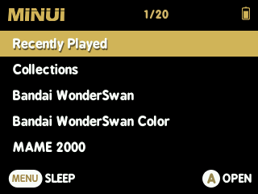
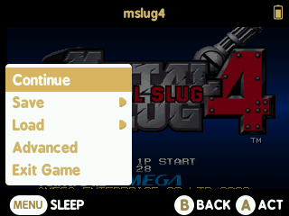
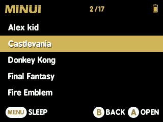
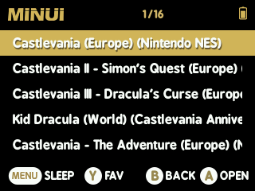
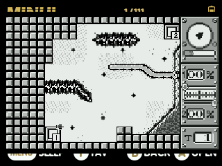

- [MinUI Legacy for Trimui Model S](#minui-legacy-for-trimui-model-s)
  * [Original key features](#original-key-features)
  * [Added features](#added-features)
  * [MinUI](#minui)
    + [Brightness, volume and sleep](#brightness--volume-and-sleep)
    + [Fake RTC](#fake-rtc)
    + [Preview](#preview)
    + [Alias (map.txt)](#alias--maptxt-)
    + [Collections](#collections)
    + [Emulator preference and fallback](#emulator-preference-and-fallback)
    + [GMenuNX](#gmenunx)
    + [OD Commander](#od-commander)
    + [Random Game PAK](#random-game-pak)
    + [Favorites](#favorites)
  * [Systems, directories and emulators](#systems--directories-and-emulators)
    + [PicoArch](#picoarch)
  * [Known issues](#known-issues)
  * [AI usage](#ai-usage)

# MinUI Legacy for Trimui Model S

     

## Original key features

- Simple launcher and straightforward SD card organization
- Consistent in-game menu with quick access to save states, disc switching, and emulator options
- Automatically hides file extensions and region/version tags in displayed game names
- Automatically enters sleep mode after 30 seconds of inactivity
- Resume from the most recently used manually created save state by pressing `X` instead of `A` in the launcher

## Added features

- PicoArch frontend with libretro cores and fallback to standalone emulators
- Simple game preview system
- Ability to switch to GMenuNX
- Collections backported from MinUI Legacy for Miyoo Mini
- `map.txt` aliases backported from MinUI Legacy for Miyoo Mini
- Clock.pak backported from MinUI Legacy for Miyoo Mini
- Fake RTC
- Random Game PAK
- Favorites
- Removed the original gradient backgrounds

## MinUI

### Brightness, volume, and sleep

| Function   | Keys                    |
| ---------- | ----------------------- |
| Brightness | `Select` + `Left/Right` |
| Volume     | `Select` + `Up/Down`    |
| Sleep      | `Menu`                  |
| Wake       | `L` + `R` + any button  |

### Fake RTC

This version includes a simple fake RTC. On the first boot, the date and time are set to January 1, 2000, at 00:00:00. Each subsequent boot advances the stored time by four hours. You can also set the date and time manually using Clock.pak under `Tools`.

### Preview

To display game previews, place `.png` files in `Roms/<system>/res/` with filenames matching the corresponding ROMs (without their extensions).

Example:

- `Roms/NEOGEO/mslug.gno`
- `Roms/NEOGEO/res/mslug.png`

Press `Start` while browsing systems or collections to toggle previews.

### Alias (map.txt)

Backported from MinUI Legacy for Miyoo Mini, `map.txt` files let you customize displayed names. You can place one in `Roms/`, `Roms/<system>/`, or `Collections/`. For example, the `Roms/map.txt` file can display the original Trimui folder `SFC` as `Nintendo SNES`.

### Collections

Also backported from MinUI Legacy for Miyoo Mini, collections let you group games together.

To create a collection, add a `<collection-name>.txt` file to `Collections/`.

### Emulator preference and fallback

When launching a game, MinUI tries your preferred emulator first (PicoArch or standalone) and falls back to the other if the preferred one is unavailable. PicoArch is preferred by default. Press `Start` + `Up` to toggle the preference. When standalone emulators are preferred, an **M** appears to the left of the battery icon.

### GMenuNX

You can switch to GMenuNX from the `Tools` menu. An entry is also added to GMenuNX so you can return to MinUI.

### OD Commander

An alternative two-pane file manager with text editing support.

### Random Game PAK

Available under `Tools`, Random Game selects a system at random and launches a randomly chosen game from it.

### Favorites

Press `Y` to add a game to Favorites from a ROM list, Collections, or Recently Played. To remove a game from Favorites, open the Favorites list and press `Y`.

## Systems, directories and emulators

| System                    | Directory   | Standalone         | PicoArch cores                                  | Notes                                                                                                                  |
| ------------------------- | ----------- | ------------------ | ----------------------------------------------- | ---------------------------------------------------------------------------------------------------------------------- |
| Amstrad GX4000            | `GX4000`    | arnold             |                                                 |                                                                                                                        |
| Arcade (MAME 2000)        | `MAME2000`  |                    | mame2000                                        | <ul><li>MAME ROM set 0.37b5</li><li>No save states</li></ul>                                                           |
| Arcade (MAME 2003)        | `MAME2003`  |                    | mame2003                                        | MAME ROM set 0.78                                                                                                      |
| Atari 2600                | `ATARI2600` | Stella             | stella                                          |                                                                                                                        |
| Atari Lynx                | `LYNX`      | handy              | handy                                           |                                                                                                                        |
| Bandai WonderSwan Color   | `WSC`       | oswan              | mednafen_wswan                                  |                                                                                                                        |
| Bandai WonderSwan         | `WS`        | oswan              | mednafen_wswan                                  |                                                                                                                        |
| Colecovision              | `COLECO`    |                    | bluemsx                                         |                                                                                                                        |
| Game Music                | `GME`       |                    | gme                                             |                                                                                                                        |
| MSX                       | `MSX`       |                    | bluemsx                                         |                                                                                                                        |
| NEC TurboGrafx-16         | `PCE`       | temper             | beetle-pce-fast                                 |                                                                                                                        |
| NEC TurboGrafx-CD         | `PCECD`     | temper             | beetle-pce-fast                                 |                                                                                                                        |
| Neo Geo Pocket Color      | `NGPC`      | race-od            | mednafen_ngp                                    |                                                                                                                        |
| Neo Geo Pocket            | `NGP`       | race-od            | mednafen_ngp                                    |                                                                                                                        |
| Neo Geo                   | `NEOGEO`    | Gngeo (Steward fu) | gngeo (based on Gngeo (Steward fu))             | Supports `GNO` files for faster loading. A converter is available [here](https://github.com/coffeecore/gngeo-gno-tool) |
| Nintendo Game Boy Advance | `GBA`       | gpsp               | gpsp                                            |                                                                                                                        |
| Nintendo Game Boy Color   | `GBC`       | gambatte           | gambatte                                        |                                                                                                                        |
| Nintendo Game Boy         | `GB`        | gambatte           | gambatte                                        |                                                                                                                        |
| Nintendo NES              | `FC`        | fceux              | <ul><li>fceumm</li><li>quicknes</li></ul>       |                                                                                                                        |
| Nintendo SNES             | `SFC`       | snes9x2002         | <ul><li>snes9x2005</li><li>snes9x2002</li></ul> |                                                                                                                        |
| PICO-8                    | `PICO8`     | retro8             |                                                 |                                                                                                                        |
| Pokemon Mini              | `POKEMINI`  | pokemini           | pokemini                                        |                                                                                                                        |
| Sega 32X                  | `32X`       | Picodrive          | picodrive                                       |                                                                                                                        |
| Sega CD                   | `SCD`       | Picodrive          | picodrive                                       |                                                                                                                        |
| Sega Game Gear            | `GG`        | sms_sdl            | smsplus-gx                                      |                                                                                                                        |
| Sega Master System        | `MS`        | sms_sdl            | smsplus-gx                                      |                                                                                                                        |
| Sega Megadrive            | `MD`        | Picodrive          | picodrive                                       |                                                                                                                        |
| Sega SG-1000              | `SG1000`    | Picodrive          | bluemsx                                         |                                                                                                                        |
| Sony Playstation          | `PS`        | pcsx_rearmed       | pcsx_rearmed                                    |                                                                                                                        |

Some systems (such as PlayStation, Neo Geo, MAME 2000, and MAME 2003) cannot run every game perfectly due to the Trimui Model S hardware limitations. The GNO converter does not support every ROM either.

### PicoArch

| Function     | Keys         |
| ------------ | ------------ |
| Fast-forward | `Menu` + `X` |
| Show FPS     | `Menu` + `B` |

## Known issues

- Fast-forward is disabled after opening and closing the in-game menu.

## AI usage

This project was developed in part with assistance from AI (ChatGPT).
